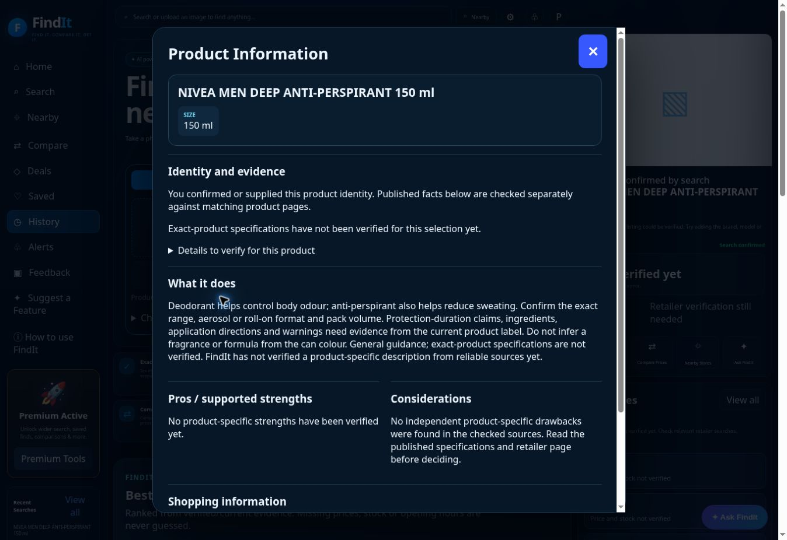

# FindIt customer feature audit — 28 October 2026

## Release decision

**Not an all-features quality pass.** Live controls were exercised, several reproducible defects were fixed, and automated regression checks were run. Exact product research and retailer discovery still returned too little useful information for two clear product images. Empty, truthfully labelled results are preferable to invented data, but do not meet the requested shopping experience.

Actual phone hardware was not available. Interactive live checks used the cloud desktop browser. Existing automated browser suites exercise phone-sized layouts, including mocked provider responses; that is not proof of real camera capture, gallery behaviour, notifications, or identical independent AI results on a phone.

## Reproducible inputs and evidence

Google Images showed an unusual-traffic verification challenge in this browser. No challenge was bypassed. Product photographs were obtained from retailer image sources instead.

| Input | Public source | Live FindIt observation |
|---|---|---|
| Clear Nivea Men Deep anti-perspirant 150 ml front photograph | [Woolworths product](https://www.woolworths.co.za/prod/Food/Toiletries-Health/Body-Care/Deodorants-Antiperspirants/Mens-Body-Spray/Nivea-for-Men-Deep-Anti-Perspirant-Body-Spray-150-ml/_/A-6001051002887) | Returned `anti perspirant`, 65%, without the visible brand. Product Info retained a possible full label reading, explicitly unconfirmed. Manual correction to `Nivea Men Deep Anti-Perspirant 150ml` was a separate action, not a successful automatic identification. No verified exact offer or product-specific strengths were returned. |
| Logitech G435 black/neon-yellow headset photograph | [Firstshop product](https://www.firstshop.co.za/products/logitech-g435-lightspeed-wireless-gaming-headset-black-and-neon-yellow-981-001050-140438) | Recognised Logitech G435 headphones at 85%. Product Info and Ask FindIt returned generic headphone guidance, without verified model specifications or retailer offers. |
| Typed `Nivea Men Deep Anti-Perspirant 150ml` | Same product identity as the photograph | Search completed and pharmacy suggestions appeared after the category fix. Exact source research remained empty in the observed search. |
| Manual barcode `5449000000996` | [Open Food Facts record](https://world.openfoodfacts.org/product/5449000000996) | Returned Coca-Cola 330 ml with catalogue attribution and linked barcode/brand/pack fields. No invented retail price or branch stock. Catalogue information is not independently measured label accuracy. |
| Invalid barcode `123`; empty text search | Validation inputs | Rejected with numeric-barcode validation / required-field message. |
| Test location `-25.7821, 28.2752` | Public Menlyn-area test coordinates; not the user's location | Manual location accepted; Leaflet loaded, zoom controls worked and clicking the map changed the pending coordinate fields. On the final retest, 12 Clicks branches loaded. Menlyn Park displayed 0.1 km; independently recomputed straight-line distance was 0.086 km (rounds to 0.1). Branch stock remained unknown. |

For an external cross-check, [Clicks product 307992](https://clicks.co.za/nivea-men_deodorant-spray-deep-150ml/p/307992) displayed Nivea Men Deep 150 ml, R52.99 and online “In Stock” during this audit. Promotional conditions were separate. This is timestamped retailer-page evidence, not a guaranteed future price or branch-stock claim. FindIt did not retrieve that listing during the observed search.

Official [Nivea](https://www.nivea.co.za/products/nivea-men-deep-aerosol-150ml-60010510028870147.html) and [Logitech](https://lightspeed.logitechg.com/g435/au/) sources were available to external research. Their existence makes the sparse in-app research a quality gap; their facts were not manually inserted as if FindIt had verified them.

## Controls from the supplied screenshots

“Observed” below means an actual live UI action and resulting state. A truthful empty state is not counted as successful retrieval of useful shopping information.

| Feature/control | Result and limit |
|---|---|
| Home / Search navigation | Navigation controls exercised; Search Product opens the named-product form. |
| Nearby navigation / product Nearby action | Entry points exercised. Final retest returned 12 Clicks branches; Check Store opened Menlyn Park details. Exact item availability remained unknown. |
| Compare / Compare Prices / Product Info comparison action | Comparison opens with the current product, and explicitly says no verified price. Populated price ranking is unverified live. |
| Deals | Opened the retailer/price view. No actual deal was returned; cannot certify deal quality. |
| Saved / Save Find | Saved Nivea, checked the success state, reloaded and reopened it. Product research refreshes separately. Storage is local to this browser, not cross-device sync. |
| History / Open product | Correct products listed. Found newly created photo history lost original identity evidence; corrected the history writers. Existing entries already missing evidence remain unverified until corrected. |
| Alerts / Watch item | Watch entry added and visible, including “Waiting for a verified price”; persisted through reload. |
| Stop watching | Removed the audit watch entry and showed an empty watchlist. |
| Enable notifications | Browser reported notifications were not enabled. Delivered notifications were not verified. |
| Background alerts | UI correctly discloses that checks occur while the site is open and that background service is not active. This is not a working background-alert feature. |
| Feedback | Deliberately labelled QA feedback submitted; success shown and draft cleared. Technical details unchecked before submission. Feedback clipboard content was not independently confirmed. |
| Suggest a Feature | Deliberately labelled QA suggestion submitted; success shown and draft cleared. A separate unsubmitted draft copied correctly to the clipboard. |
| How to use FindIt | Help dialog opened with the shopping steps. No claim that instructions prove feature correctness. |
| Upload Photo / Choose File | Two real retailer photographs selected through the visible file picker and identified through the actual service. |
| Gallery / Files / phone camera | File upload exercised; camera input declares environment capture. Native phone gallery/camera behaviour was not available to test. |
| Scan / Camera entry | Exercised. This cloud browser cannot verify actual camera capture. |
| Identify & Find | Worked for both images, but Nivea identification was too generic despite a clear label. Progress completed; not a full accuracy pass. |
| Product Info | Opens and keeps current identity. Generic guidance is marked as such. Barcode source fields populated; model-specific information was missing for Nivea/Logitech. |
| Pros / considerations | Displayed empty-evidence messages for the tested images. Real product-specific usefulness did not pass. |
| Correct model / label | Form worked. Fixed its prefill to preserve an available label hypothesis, without automatically confirming it. |
| Ask FindIt product modal | Asked a G435 Bluetooth/weight/battery question. Response admitted missing exact information but did not answer with available official specifications. Quality gap. |
| AI retailer assistant / Send / No stores? | Current Nivea context retained; answered honestly about missing price/availability and distinguished online from branch stock. No-stores chip supplied location guidance. |
| Best overall / Cheapest / Closest cards | Missing-evidence states shown. Best overall/cheapest remain unpopulated without prices. Closest correctly displayed Menlyn Park at 0.1 km after branches loaded; cross-currency ranking remains unverified live. |
| Shopping List quick action / Add current item | Added the current product; duplicates updated the same item. List persisted after reload. |
| Shopping list Remove / Clear list | Both removed audit entries. Found separate quick-action label remained selected; added a list-mutation event and synchronization fix. |
| Shopping plan Best overall / Cheapest | Both controls exercised with no prices; no total or driving route invented. One numeric automation target detached during dynamic rendering; re-targeting the visible control succeeded. |
| Shopping plan title | Fixed unconditional “Online-only plan” wording when there were zero verified retailers. No-offer state now retains “No verified shopping route yet”. |
| Check nearby stores disclosure | Final retest showed populated branch controls. Menlyn Park modal address, phone and Wednesday closing time matched the official branch page. Call and directions destinations were inspected; no telephone call was placed. Exact branch stock remains unknown. |
| Open Now | Disabled before hours loaded; became enabled for 12 published schedules and toggled on. All 12 were scheduled open, so filtering out a closed live branch was not demonstrated. Menlyn Park Wednesday closing time matched its official page. |
| Shopping barcode button / manual entry | Invalid and real barcode paths tested; camera-detection fallback shown. |
| Retailer suggestions | Relevant pharmacy suggestions restored for deodorant/anti-perspirant aliases. These are explicitly unverified search links, not offers. Google destinations could not be fully followed because of the browser's verification block. |

## Additional settings and Premium controls

Free Premium Beta was activated only in the test browser, with user authorization; no paid service was purchased.

| Feature | Observed result / coverage |
|---|---|
| Settings open, save/apply | Changed radius to 5 km, sorting to Closest first and auto-verification off. Success message shown, visible radius updated; values persisted after reload. |
| 25 km / alphabetical sorting | Selected and applied 25 km and A–Z. Result ordering with populated nearby data remains unverified. |
| Reset settings | Restored 10 km, Best match and automatic verification on. |
| Settings Refresh / location-permission controls | Not separately certified end-to-end in this pass; manual location was tested. Actual GPS/device accuracy unverified. |
| Nearby Filter | Opened Settings containing radius and sort controls. |
| Premium Workspace | Opened and displayed its tools. |
| Collections | Created `QA audit 2026-10-28`, added Nivea and observed count/name. No removal control was exposed in that view. |
| Favourite Stores | Initially asked for nearby search first. Populated branch saving is checked separately below if exercised. |
| Exact Match | Ran the current product; returned no verified listing with the correct warning. Useful retrieval failed. |
| AI Retailer Search | Opened assistant prefilled with the current product; submitted and checked the answer. |
| Premium Stats | Showed four recent finds, one saved item, zero watchlist and zero favourite stores, consistent with the state after audit cleanup. Stats disclose device-local Beta storage. |
| Premium shortcut equivalents | Saved/history/watch/filter/manual search functionality was tested through main entry points. Every equivalent Premium shortcut was not independently exercised. |
| Other underlying page controls | Example shuffle/challenge, all hidden legacy interfaces, every keyboard path was not individually certified. History capacity was additionally checked in regression tests, as noted below. |

## Fixes and verification

- PR #338: personal-care aliases in commerce/nearby routing; relevant general product guidance; correction prefill; truthful empty shopping-plan title. Merged and production `/api/version` confirmed `21e12e815e23c3faebc27e5493789440429d83b3`. Its four PR workflows passed. Post-deployment Nivea search showed pharmacy links and deodorant-specific general guidance.
- PR #339: same aliases in native catalogue discovery; shopping-list state synchronization; original photo identity retained by all history writers. Includes unit coverage and desktop removal / phone-sized clear-list browser regression.
- PR #339 merged and the live page's build stamp confirmed `f06a5e97bc3a9bf41018fb2151b38f7812996245`. Re-uploaded the same G435 image, identified it, removed its shopping-list entry and checked the separate control returned to `+ Shopping List` / `aria-pressed=false`. Reopening the newly created photo history retained Logitech / G435 / electronics and 85% instead of the older-entry warning.
- Re-uploaded the Nivea image on that build: category now beauty, pharmacy suggestions and appropriate label checklist appeared. Correction form retained `NIVEA MEN DEEP ANTI-PERSPIRANT 150 ml` without submitting automatically. Submitting that identity still returned no verified retailer facts or offer. The quality gap remains.
- Additional capacity review found two history writers capped Premium at 20 and the history dialog displayed at most 30 despite the advertised 50. The follow-up preserves 50 Premium entries and exposes all 50 in the dialog; Free uses the existing 30-entry limit. Tests cover both limits.
- Local suite after the original-identity fixes: **521 tests passed**, zero failures. The capacity follow-up passed **522 tests**, zero failures.
- The four PR #339 workflows passed: regression, Full Production Audit, Release Smoke and Interaction Freeze. Main production deployment, smoke, dashboard commerce and Final Production Audit also passed when checked. Main **Uncommon Commerce Regression failed**: no verified exact retailer page for its tuner fixture. Its live discovery failure is not hidden or relaxed.

## Final populated nearby retest

After the final pharmacy routing fix and a fresh exact-label search with the Menlyn test location, 12 Clicks branches appeared. [Clicks Menlyn Park's official branch page](https://clicks.co.za/store/Menlyn-Park/365) matched the app's address, telephone and Wednesday 09:00–20:00 schedule. Its selected-point-to-branch straight-line distance independently recomputed to 0.086 km, matching the displayed 0.1 km. This is a straight-line estimate, not a driving distance.

The populated dashboard revealed its map panel was still decorative and its old Map view target was hidden. The follow-up replaces those decorative pins with real Leaflet markers for returned branch coordinates, a separately labelled selected search point, accessible Check Store popups and tile-error guidance. Existing map assets and tile service are reused. No branch product stock is inferred from a marker.

The main `f06a5e9` Interaction Freeze run timed out while navigating production before the shopping test started; the relevant local test passed. It was rerun rather than silently classified as an application pass. PR #340's capacity-only head passed all four PR suites before adding the map repair.

## Remaining release blockers

1. Clear-label Nivea photograph was reduced to a generic object. Label hypotheses are not confirmed identities.
2. Exact research and retailer discovery returned no useful verified offers for Nivea or G435 despite external product pages. Generic pros/cons and Ask answers are insufficient for the desired product experience.
3. Exact live branch stock, branch prices, price-based route planning and deals were not established. Relevant branch discovery did work on the final Nivea retest. One branch address/phone/schedule and rounded straight-line distance were independently cross-checked; that is not verification of every branch or exceptional opening day.
4. Native phone camera/gallery, actual GPS, notification receipt and background operation were not available for verification.
5. Independent AI calls are nondeterministic; local browser storage does not synchronize devices. Identical independent answers and shared saved state have not been demonstrated.

No paid data provider was added. No missing source facts, prices, stock, phone numbers or hours were fabricated to make this audit pass.
