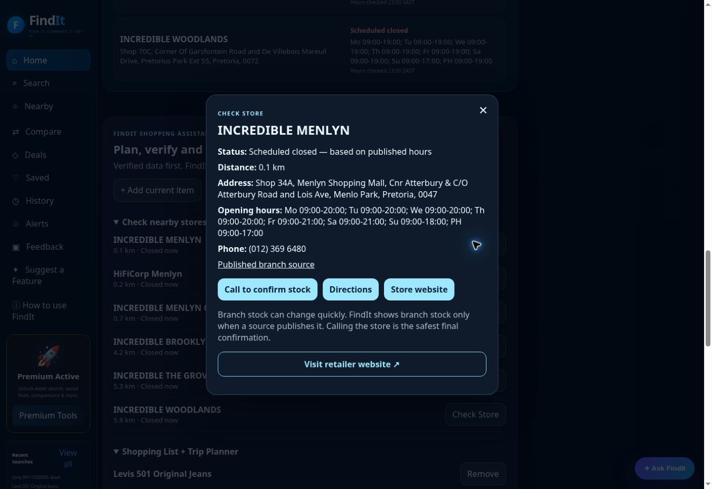

# FindIt Nearby — commerce and branch continuation, 24 October 2026

Launch certification remains withheld. This report supplements the input/identity continuation and earlier launch audits. Preserved the existing design and features; no paid service was activated.

## Repairs

- PR #312: category word collisions (chair/hair, Moleskine/skin, dressing table/dress, Fortuner/tuner), and selection of sourced functional product descriptions.
- PR #314: public product-page URL and redirect validation; conditional +more member prices retained in offer cards, headline and Smart Choice. Reader fallback cannot bypass a rejected redirect. Product price caveats are scoped to the primary product area, excluding recommendations and inert markup.
- PR #316: reviewed the concurrent HiFi Corp +more badge repair and merged after its isolated tests and all branch checks passed.
- PR #315: consistent whole-word category matching across backend discovery, retailer selection and nearby routes. Synthetic leather furniture and baby bassinets no longer route through synth/bass music substrings.
- PR #317: listings with different published variants, source size/colour attributes, eligibility terms or currencies cannot be ranked as the cheapest equivalent item. Preserved all listing links and prices with explicit names. The same comparison rule applies to API bestPrice, dashboard headlines, Smart Choice, Ask FindIt, shopping plans, watches and price history. Watches retain listing identity and do not manufacture a price drop when the retailer switches variants. Equivalent quantity/multiplier spacing still compares; a release test caught and prompted correction of this overly strict case.
- PR #318: public Incredible and HiFi Corp locators supply active physical South African branches, published addresses, contacts and schedules. Independent name/location checks prevent caller-provided details from being treated as verified. Official data wins over a nearby duplicate map record. Missing/conflicting/exceptional schedules remain unknown. Source requests are cached/coalesced and tolerate provider failure. No branch inventory or price is inferred. The full interaction suite now also runs before merge; valid synthetic offers identify the same product, and browser regressions explicitly reject different or unnamed variants.

The parallel identity/input repairs (#311 and #313) are preserved, including fractional quantities, equivalent metric units/GTINs and truthful invalid-input responses. PR #308 was already merged on review. Old diagnostic branches labelled not to merge were not applied blindly.

## Verification and limits

468 Node tests pass locally, with syntax checks and clean diff checks. These include wrong variants, conditions, currencies, quantities, source redirects, malformed pages, unavailable map/locator services, invalid or nonphysical branches, exceptional hours and independent branch identity. CI browser tests supplement these with desktop and 390 px layouts and existing feature regressions. Mocked tests establish logic, not real retailer coverage.

Actual browser journeys include Sony WH-1000XM5 black text search, sourced purpose/specifications and R5999 member-price qualification; Levi’s 501 searches exposing multiple wash/colour listings; barcode checksum rejection and valid Coca-Cola 330 ml catalogue lookup; microphone and conditioner photo uploads with explicit partial-identity recovery; Ask FindIt grounding; manual public Menlyn coordinates; map opening/zoom. Saved/list persistence and reopening are also documented in the identity/input continuation.

The baseline eleven-query commerce sample returned priced listings for five queries. A later eleven-query run on stable deployment `3050ed7f` returned four priced-query results: Sony, Levi’s, Logitech and LEGO. Sony’s two listings both retained their +more conditions; Levi’s nine variants yielded no bestPrice. The second run used slightly different wording for the drill and bookcase. A separate unchanged-query run on stable `3050ed7f` recovered the explicit Bosch drill kit and matched the five-query baseline coverage. Omitting “drill” still exposed wording sensitivity in discovery; this remains a coverage limitation. Several products had zero accessible verified offers; this is incomplete discovery coverage, not evidence of market unavailability. The real five-photo sample mostly returned partial identities. A Twinsaver model-level recognition did not yield a verified priced offer. Assisted product selection must not be reported as automatic exact recognition.

PR #319 addresses an integration gap caught by the actual browser: typed model-only identities retained generic object/category fields, so nearby routing missed electronics even though commerce classified them correctly. Nearby now supplements its context with that existing commerce classification. The regression uses the exact generic browser fields rather than supplying the desired category.

The public electronics source pages currently contain 93 usable Incredible and 58 HiFi Corp physical branch records. This is locator coverage, not stock coverage. Published hours support scheduled opening status and cannot certify an unexpected closure.

## Remaining launch blockers

- Broad automatic exact photo-to-priced-offer success is not demonstrated. Provider errors, unavailable Hugging Face credits and disagreements remain visible; identity gates were not weakened.
- Retailer discovery still misses real products and variants. Public source availability and reliable SKU/variant equivalence remain incomplete.
- Authoritative SKU-by-branch inventory/price feeds are absent. Online stock never proves physical branch inventory; stock-based trip eligibility is not inferred. General navigation to a published store remains available.
- Physical phone camera, GPS permission, OS drag/drop and a full real-device matrix are uncertified. Cloud browser/manual barcode and responsive CI are narrower evidence.
- Durable background alerts/notifications and central analytics are not configured. No claim of server-side continuous monitoring is made.
- The TMB page was checked again: this cloud browser rendered GBP225.44 after client-side conversion while its country control still said South Africa/ZAR. FindIt’s earlier source result was ZAR4999; independent rand rendering remains uncertified. This must not be described as a verified same-currency browser comparison.

## Final deployed customer checks

The Worker version and actual browser build metadata both report `f9416ecc9ad10e70312042804bc61151d6bb941e` (#319). #317, #318 and #319 passed their branch regression/full audit/release gates before merge; #318/#319 additionally passed the expanded pre-merge interaction suite.

On this final browser build, entered public Menlyn coordinates (-25.7821, 28.2752), then searched **Sony WH-1000XM5 black** without adding a product-type/category hint. The actual 10 km customer journey returned six official electronics branches. Nearest: Incredible Menlyn at 0.1 km, HiFiCorp Menlyn at 0.2 km, Incredible Menlyn on Maine at 0.7 km. Published schedules correctly showed closed at the test time in South Africa. Open Now reported 0 of 6 published schedules open. Check Store rendered the published address, (012) 369 6480, weekly/holiday schedule and source link; general store directions were retained. It did not claim the Sony item was in stock there.

The same model-only API request at 3 km returned three official branches, with null branch prices and false branch-stock/price verification. Independent hours and website checks returned published source details. Start/end version matched `f9416ecc`; the combined multi-endpoint check took 43.22 seconds, not a single-request latency measurement. See `electronics-model-only-deployed-check.json` and `electronics-final-browser.txt`.

Sony remained R5999 ZAR with the +more qualifier visible for both online sellers. Saved Sony survived refresh and reopened fresh research. The actual Levi’s journey preserved nine wash/colour listings while withholding a cheapest-equivalent claim; Ask FindIt explained that distinction and separated online from branch stock. A shopping-list entry retained its missing comparable-price state.

Eight additional production input cases captured seven actionable 400 rejections (invalid/null/malformed search, bad barcode checksum, invalid latitude, nonpublic website, null assistant) and a clean empty product-insights response for absent URL identity. The latter endpoint’s empty-result contract was checked separately rather than mislabelling it as an AI failure. These validation cases ran on #318; #319 changes category routing only.

Passing tests do not establish zero future defects or full launch readiness.

## Seven-priority status

| Priority | Demonstrated evidence | Still unresolved |
|---|---|---|
| AI photo identification | Real chooser uploads and five-photo API sample; partial identities do not become exact price claims | Broad automatic exact recognition and photo-to-offer coverage |
| Exact retailer matching | Variant/quantity/model/package regressions; eleven unchanged production queries | Five priced queries, six with no verified prices; wording sensitivity and wider catalogue coverage |
| Product information | Sourced Sony purpose, specifications, member-price terms and per-listing Levi’s variants | Facts remain dependent on retrievable sources; no invented independent reviews |
| Ask FindIt | Real Levi’s answer lists named variants and refuses cheapest equivalence; online stock remains separate from branch stock | Broader uncommon-product conversations not certified |
| Prices and locations | Member terms visible for both Sony sellers; official electronics locator, phone/address/hours verification | No authoritative item-by-branch stock/price feeds; regional currency rendering differs at TMB |
| Other existing features | Saved Sony survives refresh and reopens fresh research; list keeps variant ambiguity; map open/zoom; barcode catalogue/checksum; browser interaction regressions | Physical camera/GPS, all OS/mobile devices, durable background alerts and central analytics |
| Launch testing | 468 Node tests; pre-merge release, full audit and interaction gates; live API/browser evidence | No claim of universal product coverage, endurance or complete launch readiness |

Production workflow snapshot at 21:55 UTC: **10 completed successfully, one still running**. Deployment, regression, full/final audit, release/production smoke, dashboard commerce and the live-photo probe are green. The post-deployment Interaction Freeze workflow is still in its Install Playwright step, before its test scripts; it is not counted as passed. The same full local interaction suite passed on the PR before merge. Live status: https://github.com/bgbrummer-collab/Findit-nearby/actions/runs/40135862075. The snapshot is in `commerce-locator-final-workflows.json`; it does not imply later completion or background agent monitoring.

