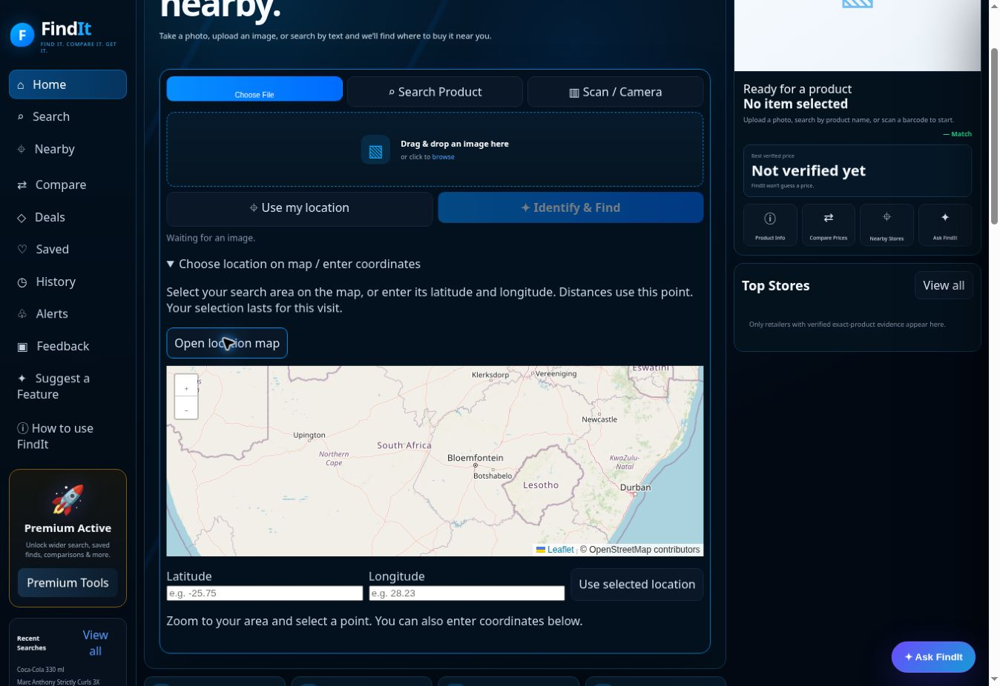

# FindIt Nearby — 25 October 2026 continuation

**Launch readiness remains withheld.** This is a continuation of the existing application, not a rebuild. No design or feature removal, paid service activation, or new credentials.

## Reviewed baseline

Reviewed main `b56fe334`, runtime `f9416ecc`, the October 24 continuation reports and their earlier October 17/18/23 audit references, deployment configuration, current tests and open PRs. PR #308 was already merged; #309–#319 repairs remain preserved. Historical diagnostic PRs explicitly marked not to merge were not applied. Yesterday's final Interaction Freeze run `40135862075` is now confirmed successful, alongside the other final runtime workflows.

## Repairs

- **PR #321 — map recovery:** the inline loader retained a rejected promise for the entire visit and had no deadline. Leaflet 1.9.4 now ships with FindIt's existing static assets, including its license, CSS and all marker/layer images. Concurrent requests share one bounded load; failed assets are removed and a subsequent attempt can retry. CSS and JavaScript both have to succeed. Tile failures/stalls are explained without claiming that a blank map is useful geographic imagery; manual coordinates and retailer details remain available. Reopening retries existing tiles. A failed reopen cannot destroy an initialized map's controls. Seven regression cases cover these paths.
- **PR #323 — requested packages:** the actual query “Bosch GSB 18V-50 drill kit” returned no offers. A failing regression reproduced rejection of an explicitly requested kit when a retailer spells out batteries and charger without the noun “kit”. That wording can now establish a package, while the exact brand/model/quantity/colour/barcode checks remain. Bare-model searches still reject packages. Missing/separately sold components cannot establish a kit. Eleven added tests include wrong model and standalone-product rejection.
- **Concurrent PR #322:** reviewed the separate model-only tool-package routing repair. It addresses bundled “charger” terms selecting electronics ahead of an established tool identity. Its changes must be preserved when combining repairs; it is distinct from #323's package-title equivalence.

## Fresh production evidence

A ten-query baseline ran with two independent journeys in parallel, on runtime `f9416ecc` from beginning to end. Six baseline queries returned priced listings: Sony WH-1000XM5 black (two ZAR5999 +more-qualified listings), Logitech PRO X 981-000818 (ZAR2299), LEGO 10696 (ZAR559), Levi's 501 (nine explicitly named variants), Nivea body lotion 250ml (ZAR59.99), Shure MV7+ (ZAR7095). No verified offers were returned for Coca-Cola Original Taste 2L, bare Bosch GSB 18V-50, the drill-kit wording, or Twinsaver Comfort 3 Ply Tissues 120. Empty results are not proof of market unavailability. The API-only matrix checks retailer results, not researched information or completed browser purchases. The initial capture did not separately retain HTTP status; its files explicitly say so, rather than inventing HTTP-status passes.

Real microphone and conditioner browser uploads used the file chooser and Identify & Find, with no product-name query. Both remained partial. The microphone received useful general-type guidance without a guessed exact model. The conditioner offered a source-linked candidate; selecting it explicitly recovered Clicks ZAR230 and sourced ingredients, usage, warnings and purpose. This is assisted selection, not automatic exact photo recognition.

Additional neutral-filename photo API uploads (Nike, glasses, Twinsaver) all remained partial. Diagnostics include unavailable Cloudflare/Gemini readings and repeated Hugging Face HTTP402/credits-unavailable responses. Their unsupported model suggestions did not become exact offers. The five-photo bounded sample therefore does not demonstrate broad automatic exact identification.

The independent Clicks browser page confirmed the same 250 ml item, R230 and online In Stock. FindIt conservatively left availability unknown where its retrieved source omitted it; branch stock remained unverified.

The actual conditioner Ask FindIt question combined purpose, price and nearest-branch stock. It returned source-linked purpose/specifications, ZAR230, no verified online availability, and no branch-stock claim. Public Menlyn coordinates (-25.7821, 28.2752) returned twelve Clicks branches, nearest about 0.1 km, published addresses/phones/schedules, and scheduled closed status at the test time. Smart Choice kept the online offer separate from physical branch stock. Check Store showed Menlyn Park address, 012 348 6162, source and general directions. A published schedule does not certify unexpected closure or inventory.

Shopping-list addition and Save Find succeeded. After refresh, the saved item remained and reopened fresh research; the shopping list retained its online-only plan without inventing a stock-confirmed driving trip. Invalid barcode checksum `5449000000997` produced an actionable error; valid `5449000000996` then returned Coca-Cola 330 ml with Open Food Facts provenance and no invented retailer price; camera decoding is unsupported in this cloud browser. Physical scanning, camera, real GPS permissions and a physical phone matrix remain uncertified.

## Verification

PR #321 passed Node regression, Full Production Audit, Release Smoke and Interaction Freeze before merge as `43c70c351`. The deployed Worker and browser meta build both matched that commit. Actual Open location map, Zoom in and reopening succeeded; all eight observed map tile images completed with 256 px natural width. The same final `a49ff40a` browser map also loaded all eight observed tiles successfully with no imagery warning. The library and CSS loaded from FindIt’s own `/assets/leaflet/` URLs. Screenshot and browser evidence are retained.

The separately reviewed #322 routing repair passed all four branch checks and was merged as `1c3cab4d`. Combined local integration of #321/#322/#323 passes **491 Node tests**, syntax and diff checks. #323 passed all four latest-head branch gates and merged as `a49ff40a`. The deployed Worker and actual browser build metadata matched that commit.

On stable deployed `a49ff40a`, the same ten-query matrix now returns priced listings for **7/10 searches**, up from 6/10: the explicit drill-kit query recovers TMB’s fully named batteries/charger package at source-published ZAR4999. The bare model still returns no verified listing. A separate final model-only “Bosch GSB 18V-50 with batteries and charger” check recovers the package and selects hardware/doityourself map tags. All live map discovery providers returned no usable hardware data in that run, so the response explicitly reported retrieval unavailable rather than claiming that no stores exist. The other no-offer cases are Coca-Cola 2L and Twinsaver facial tissues. Each final request separately captures HTTP 200; start/end runtime versions match. Levi’s nine named variants remain distinct.

The real browser kit journey rendered source-linked purpose, voltage/torque/chuck and other specifications, the package contents and Professional 18V compatibility; Compare Prices showed the fully named package with online stock separated from unknown branch stock. Ask FindIt independently returned the listed two GBA 18V 2.0Ah batteries, GAL18V-20 charger and sourced compatibility. The actual TMB page confirms the same product, contents and specifications, but this cloud browser displays GBP225.57 while its country control still says South Africa/ZAR. The earlier regional currency discrepancy persists; this is not a verified same-currency browser price comparison.

Post-deployment Release Smoke run `40214961390` failed on an outdated wording assertion: its output correctly said “Exact branch stock not verified”, while the test only accepted different synonymous labels. The captured output did not invent branch stock or directions. Test-only PR #324 accepts both existing uncertainty labels and additionally rejects unsupported maps/directions links in the nearby cards. PR #324 passed Node regression, Full Production Audit, Release Smoke and Interaction Freeze before merge as `cc140f2e`. The application source is unchanged by that test-only commit. Its final post-merge workflow snapshot will be added below. The initial failed run is retained, not relabelled as passed.

Eight additional live invalid-input/security cases returned their expected actionable HTTP400 responses: null/malformed search, object query, invalid barcode, null assistant, invalid latitude, nonpublic retailer URL and overlong query. `deployed-inputs.json` separately captures actual HTTP status.

Local standalone Playwright execution could not start because the browser binary was absent and its download failed in this environment. It is not recorded as a passing local browser suite; the actual cloud-browser journeys and completed GitHub browser gates provide separate evidence.

## Seven-priority status

| Priority | Demonstrated | Remaining |
|---|---|---|
| Photo identification | Five real photos; partial identity and assisted candidate recovery stay labelled | No broad automatic exact-photo success demonstrated |
| Exact retailer matching | Unchanged ten-query before/after sample; package and wrong-model regressions; seven final priced searches | Three final queries without verified offers; source coverage incomplete |
| Product information | Conditioner source-linked purpose, ingredients, usage and warnings; microphone general guidance; barcode catalogue provenance | Unknown facts remain unknown; accessible sources vary |
| Ask FindIt | Actual combined purpose/price/nearest-stock question answered with sources and stock uncertainty | Broad uncommon-product conversational coverage uncertified |
| Prices and locations | Qualified Sony online prices; twelve named Menlyn branches with published details | No authoritative SKU-by-branch prices/stock; TMB regional rendering difference remains |
| Existing shopping/mobile features | List/save persistence and fresh reopening; real file chooser; valid/invalid barcode; map zoom/reopen | Camera/GPS/physical devices, background alerts and central analytics uncertified |
| Launch testing | 491 combined Node tests, branch browser gates, live browser and API evidence; release wording repair recorded | Launch readiness withheld for recognition and coverage gaps |

## Remaining limitations

- Broad exact photo recognition is inadequate in the demonstrated sample. Provider disagreement and unavailable credits cannot be repaired by lowering identity checks or assuming a candidate matches.
- Retailer/category coverage remains incomplete. Accessible listings, package variants and search wording still affect results; further retailer integration work remains possible.
- No authoritative product-by-branch stock/price feed is connected. Online stock and prices cannot certify branch inventory or an in-store price.
- Physical phone camera/GPS, OS-specific upload/drag-and-drop behavior, endurance and a complete accessibility/device matrix are not certified by desktop/cloud or responsive CI.
- Durable background notifications and central analytics remain unconfigured. Local watch/list records are not proof of continuous server monitoring.
- Previous source/browser currency differences at TMB are not silently reclassified as resolved.

Passing tests do not establish universal coverage, zero future failures or public launch readiness.

