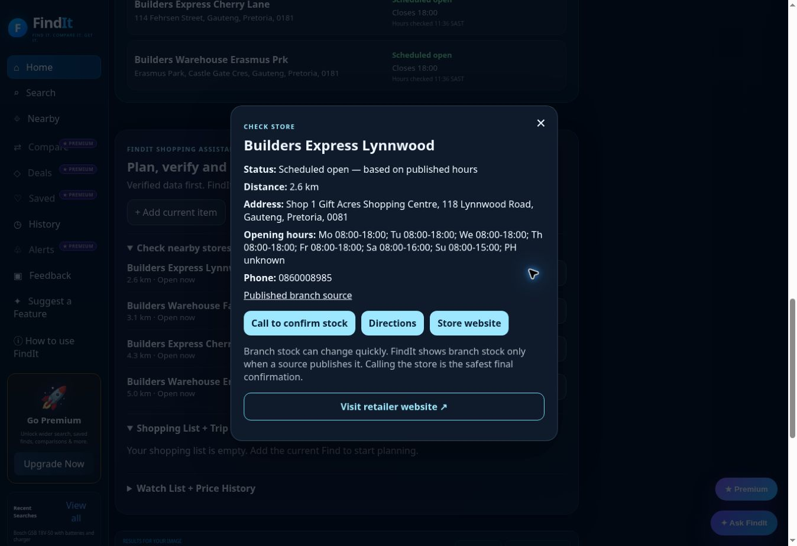

# FindIt Nearby — 26 October 2026 continuation

Launch readiness remains withheld. Preserved the existing application design and features; no paid services or credentials were added.

## Baseline and repair

Continued from main `b99eb817` and deployed runtime `cc140f2e`, after reviewing the October 25 audit. PRs #321–#324 are already merged and are preserved.

PR #325 adds a public official Builders locator fallback to the active Worker nearby route, legacy nearby route, independent branch-hours research and website checks. The public national-list endpoint is the one used by Builders' own store finder. Fixed public sorting coordinates are used; a shopper's location is not sent to Builders. Distances are recalculated from the customer's selected point in FindIt.

The source returned 125 branch records. Only 79 passed conservative validation. Foreign, closed, nonphysical, malformed and duplicate records are excluded. Some source map pins contradict the address coordinates by kilometres; these records are excluded rather than choosing a potentially wrong pin. Missing/public-holiday/exceptional schedules remain unknown. Official branch details override conflicting map contacts only after independent name and location matching. Collection/delivery capabilities never establish SKU stock, branch prices or stock-based trip eligibility.

The API publishes legacy `/store/{id}` URLs which the current website renders as unavailable. FindIt links to the working official store finder instead. An actual retailer browser journey searched Lynnwood and opened View details: its name, address, 0860008985 contact and ordinary weekly hours matched the parsed source. This is published contact/schedule verification, not proof of live inventory or an unexpected closure.

## CI installation repair

The first full-audit job timed out before testing while downloading Ubuntu fonts from an OS mirror. The original install log is retained, not counted as an application-test pass. Nine existing browser workflows now use Microsoft’s public prebuilt `mcr.microsoft.com/playwright:v1.55.0-noble` image, matching the existing npm Playwright 1.55.0 package. The image tag was checked at the official registry. Existing test commands, triggers, permissions and timeouts are preserved; explicit Bash retains script semantics. Only redundant browser/OS installation is removed. YAML comparison verified that all other steps/settings remain unchanged. The latest-head full audit now reaches and passes its actual browser tests.

## Validation so far

498 Node tests pass, with syntax and diff checks. Seven added tests cover parser exclusions, inconsistent coordinates, AM/PM schedules, independent branch identity, duplicate precedence, both nearby routes during map outages, branch details/hours, coalesced requests and unavailable/malformed providers. Mocked logic tests are separate from actual source coverage.

The deployed baseline nearby API and actual customer browser both reported retrieval unavailable for the model-only Bosch package at public Menlyn coordinates (-25.7821, 28.2752). The changed local Worker, using real network sources, returns four accepted branches: Builders Express Lynnwood (2.65 km), Builders Warehouse Faerie Glen (3.14 km), Builders Express Cherry Lane (4.35 km), and Builders Warehouse Erasmus Prk (5.05 km). Independent hours and website checks return source-published details while retaining unknown branch product stock and prices. Source, before/local responses, browser text and test logs are in `launch-evidence-2026-10-26/`.

## Deployed verification

All four latest-head PR gates passed before PR #325 merged as `d40df7c15a2fdc7a85b16c2e8b89ac744fcb084d`. Cloudflare deployment succeeded. Worker `/api/version` and actual browser meta build both report that commit.

The exact unchanged customer query was repeated through Search Product on the live website with public Menlyn coordinates. Product information still renders sourced purpose, specifications, package contents and Professional 18V compatibility. Nearby Stores now shows the four accepted Builders branches with recalculated distances and explicit “Branch stock not verified” labels. Independent deployed API hours and website checks return published details. The real Check Store control for Lynnwood shows its address, 0860008985, ordinary weekly hours, source link and scheduled-open status; the dashboard reports 4 of 4 published schedules open at the Monday test time. These schedules cannot certify an unexpected closure. TMB's online offer remains separate from branch inventory and prices.

The original retrieval failure and final browser/API responses are archived. The screenshot below is from the deployed customer flow. Final main-workflow status is recorded separately; running workflows are not counted as passed.

## Post-deployment QA follow-up

The initial main snapshot is retained, including three failures: the layout version gate relied on `jq` inside the new image, and the two historical synthetic-label audits clicked offscreen legacy controls before photo identification could run. Their old success-report steps also wrote commits back to main, risking version changes during concurrent checks.

PR #326 changes the audits to the current visible picker/location/Identify controls and current search state, preserves recognition/commerce/stock assertions, replaces the version parser with Node plus an exact Bash frontend stamp match, and publishes report artifacts/job summaries without modifying main. Workflow YAML and positive/negative version-gate checks pass. Latest-head Node, local layout, full-audit, release-smoke and interaction checks pass. The multi-product synthetic-label audit passed at c9513195. The trust audit completed 30/44 checks: its obsolete removed seller section caused 12 failures, while its blanket rejection of even explicitly unknown-stock nearby cards caused two more. The original log is archived. Follow-up head a2aa25c9 checks the current #fxTopStores evidence surface, requires verified-listing or explicit no-match/unknown-price disclosure, requires unknown-stock labels for unverified branches, and retains the prohibition on stock-based Directions. That revision reached 42/44; the two remaining checks expected retailer-search links where nearby-only rows were correctly labelled Nearby. Final head 7815fb4b checks that separate state with explicit unknown-stock disclosure and no unsupported stock claim. All seven final-head PR checks passed, including 44/44 trust assertions and multi-product QA. PR #326 merged as caf45c113a9bb35d4f16898ead98515cfbbc8b62. Post-merge Cloudflare deployment succeeded. API version and the CI frontend/backend version gate confirm caf45c11. The full production responsive suite passed: eight viewport sizes, upload/manual-location controls at three sizes, saved-product persistence and reopening, and consent/draft recovery with simulated feedback delivery. Dashboard commerce, production smoke, release smoke and trust QA also passed. Interaction and multi-product reruns also passed. All eleven workflows associated with caf45c11 completed successfully; their final status snapshot is archived. This closes this repair pass, while the remaining launch limits below remain unresolved. Synthetic labels are not representative real-photo accuracy measurements.

## Remaining work

The October 25 recognition and product-coverage limits remain: no broad automatic exact-photo success, incomplete retailer listings, no authoritative product-by-branch inventory/prices, uncertified physical phone/camera/GPS behavior, and unconfigured durable notifications/central analytics. This branch does not resolve those limitations.

Photo fixture uploads remain blocked by automatic approval review pending explicit permission to share the conditioner test image with FindIt and its vision providers. No upload workaround was used. The new hardware checks use public text/product and public Menlyn coordinates.
