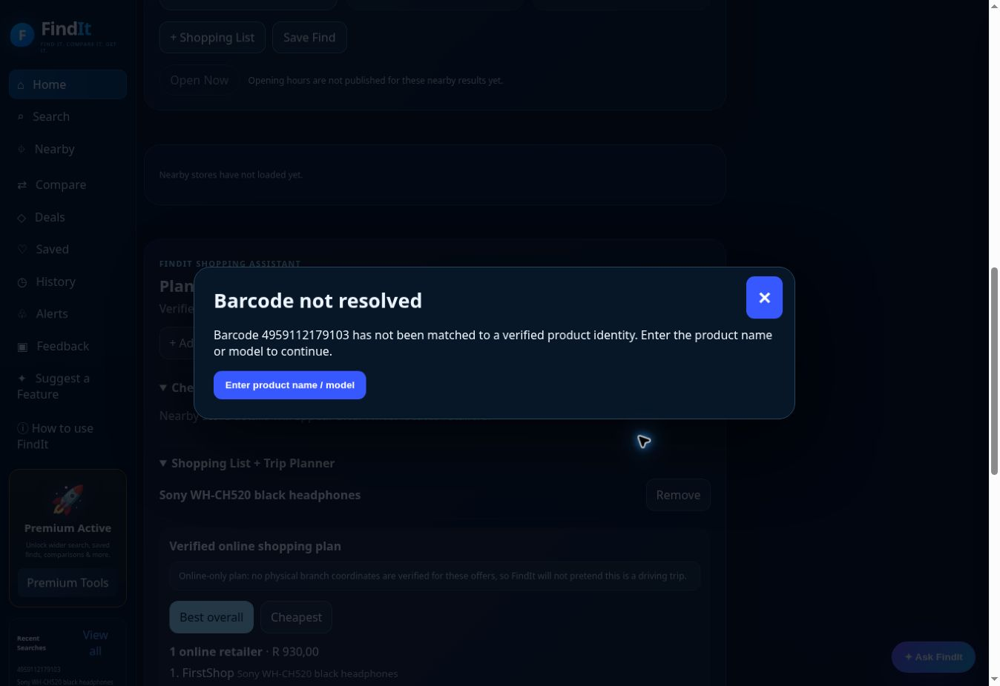
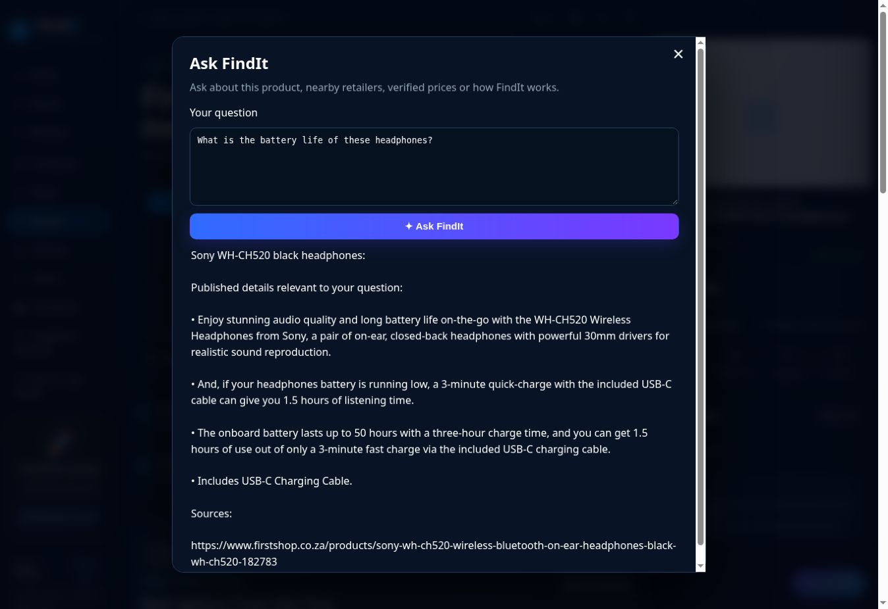

# FindIt production verification, 7 November 2026

Launch readiness remains blocked by incomplete exact discovery, photo identification and retailer data access.

## Verified checkpoints

- PR #361 merged as 393c7cf. Market-scoped authorized catalogue contract, retailer diversity and uncommon-product recovery.
- PR #362 merged as 5fb11c3. Public catalogue routes, dated official electronics locators and variant ambiguity safeguards.
- PR #363 merged as f4f5ef2. Unresolved barcode recovery, garment identity checks, sourced attribute answers and review-claim cleanup.
- PR #364 merged as dae8414. Shared dialog styles initialize independently of which feature opens first. The live browser confirmed fixed positioning within the viewport and a fully styled Ask FindIt answer.

Final application commit: dae84142580f59bb8cd50723071eaa2466c37972. The live version endpoint returned this SHA.

The existing website and feature set are retained. The free Premium Beta activation was used in a dedicated test browser to exercise saved items and shopping tools. No payment was made.

## Production measurements

| Check | Observation |
| --- | --- |
| Unit checks | 700 passed, including after the layout repair. |
| Release checks | All 13 workflows on f4f5ef2 succeeded. All nine applicable workflows on the final dae8414 release also succeeded, including deployment and final production audit. Some UI suites use fixture data. Their success does not establish live retailer coverage. |
| Targeted acceptance on f4f5ef2 and dae8414 | 7/7 passed with a stable production commit. Covers unresolved barcode handling, sourced battery answer, two clothing substitution exclusions, live uncommon-product price and bounded nearby branches. |
| Broad 16-product matrix on 5fb11c3 | 3 complete journeys passed. One additional mouse journey returned non-JSON HTTP 500. Two subsequent controlled mouse commerce requests succeeded at R699 from FirstShop. The intermittent transport error remains open. |
| Additional 8-product matrix on 5fb11c3 | Four independently accepted priced journeys, Sony WH-CH520, Logitech G502 HERO, Korg Pitchclip 2 and LEGO 10696. Automated flags initially counted a differently named clothing substitute. Both observed clothing substitutions were rejected in the final acceptance test. Empty clothing results are coverage failures. |
| Photo sample on f4f5ef2 | Five real fixture uploads. Twinsaver returned a detailed 18-roll/twin-ply identity. Conditioner, Nike shoes, microphone and glasses returned partial identities requiring confirmation. These counts measure supported specificity, rather than a general accuracy percentage. |
| Additional new photo | A sourced Sony headphone image returned Sony headphones without a confirmed model. Three other product-image acquisition attempts failed before identification. The Hugging Face backup reported HTTP 402/credits during the Sony attempt, while the existing Gemini/Cloudflare readers returned identity claims. |
| Nearby around Menlyn at 8 km | Electronics, hardware and sports returned relevant branches, 3/6 tested categories, versus 2/6 before the electronics locator repair. Music, groceries and clothing remained empty. Electronics returned six official locations. Exact branch stock remains unverified. |
| Nearby at 5 km | API and browser checks retained four relevant electronics branches, with map pins and distances. |

The price results describe sampled online listings with published currencies and conditions. Checkout totals, delivery charges and physical branch prices have separate evidence requirements.

## Retailer status observed in production

| Retailer group | Status |
| --- | --- |
| FirstShop | Exact priced mouse, mouse-pad and Sony headphone listings observed. |
| Central Vet and Petworld | Exact Royal Canin 2 kg online offers observed. |
| Orms | Exact Canon EOS R50 listings observed. |
| LEGO Certified Stores | Exact LEGO 10696 listing observed. |
| OneStopMusic and DistriNode | Exact Korg Pitchclip 2 listings observed with ZAR prices. DistriNode reported out of stock online. |
| Incredible Connection and HiFi Corp | Official nearby branch locations verified. Exact priced catalogue coverage remains unverified in this production sample. |
| Sportsmans Warehouse and Builders | Relevant official nearby branches observed. This does not establish exact item stock. |
| PEP and Ackermans | Public catalogue discovery routes added. Separate source reads produced product data, but no exact priced production discovery was established in the final sampled searches. |
| Makro | Public search route and selection parameters corrected. Exact priced production discovery remains unverified. |
| Takealot, Game, Checkers, Pick n Pay, Woolworths, Mr Price, Clicks and Dis-Chem | Broad reliable coverage remains unverified by this session's production sample. Catalogue reads varied between readable pages, JavaScript shells, HTTP 403 responses and timeouts. Earlier limited Clicks observations do not establish broad retailer coverage. |
| Amazon, Walmart, Target, Best Buy and other international retailers | The country/currency gateway contract is prepared. An active authorized catalogue connection has not been established. |

A verified listing for one item does not certify a retailer's entire catalogue.

## UI checks

Actual browser operations covered text search, gallery/file upload, camera file selection, partial-photo recovery, manual barcode entry, unresolved barcode recovery, sourced Product Information, Ask FindIt, free beta activation, saved product reopening after reload, shopping list persistence, watchlist confirmation, radius persistence, manual location, nearby branches and map pins.

The cloud browser reported that live camera barcode detection was unsupported and offered manual entry. Physical phone-camera capture remains a device test. Desktop/mobile regression suites provide emulated UI coverage. Product-data journeys are reported separately above.

The visual inspection also found shared dialogs whose base styles depended on which feature created them first. PR #364 initializes the existing styles independently and adds a viewport-layout assertion.

## Remaining dependencies and blockers

1. Production health reports authorizedCatalogueConfigured=false. Reliable broad retailer and international coverage needs an approved catalogue endpoint and its token, backed by authorized retailer APIs or feeds with original observation timestamps.
2. Physical branch stock and branch prices need exact item/store inventory evidence. Public locator and online offer data alone cannot supply this.
3. Exact photo identification remains partial across several categories. Additional unlabelled appearance does not establish a model or variant. The paid-credit error was recorded without purchasing credits.
4. Intermittent HTTP 500 and source access/timeouts remain reliability issues. Cloudflare runtime diagnostics would be needed to determine the observed non-JSON response's exact cause.
5. The connected Vercel project contains Supabase configuration and legacy import code. The connector masked the sensitive database credential, so the imported catalogue's contents and freshness were not established. It must not be described as empty or activated as trusted current stock without inspection.
6. Price/retailer-source reliability and complete physical-device parity remain below launch requirements despite the targeted repairs.

Detailed JSON evidence is in launch-evidence-2026-11-07. The final acceptance branch preserves this report without creating another application deployment.

