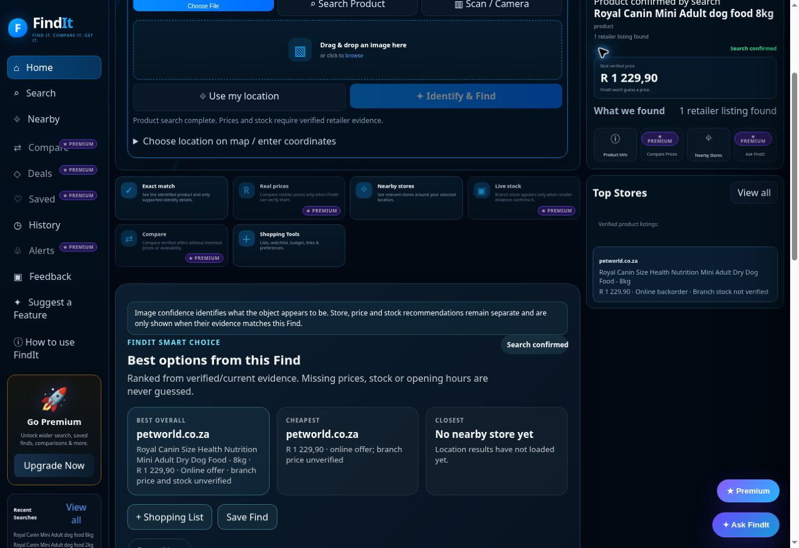

# FindIt Nearby acceptance evidence — 3 November 2026

**Recommendation: NOT LAUNCH-READY.** This is the original bgbrummer-collab/Findit-nearby project. No redesign, rebuild, entitlement change, paid service activation or credential change was performed.

## Release and review scope

Reviewed the October17/18 checklists, November2 acceptance report, November3 checkpoints and selected-variant report, current code/workflows, latest main/PRs and actual production interface. Prior repairs #353–#358 were retained. #359 was tested through four hosted checks before merge/deployment. Its ten production workflows succeeded; both actual browser build metadata and /api/version were e0930a5ccbb35ce7042a2761200a392fee3fee95. #360 deployed as86f513cf4e0121634a5963efceb7174721615787 after four hosted PR checks passed. Actual browser frontend metadata and /api/version both match this commit. Final workflows:10 succeeded,1 failed. The failed Uncommon Commerce Regression (run41639807984) returns no exact Korg Pitchclip2 offer; this prior gap is retained, not waived.

The architecture is a Cloudflare Worker backend plus the retained layered static browser scripts. Existing Vercel Gemini/feedback services and Workers AI bindings remain configured. Health output is configuration-only, not an inference or third-party availability test. API credentials and billing usage were not retrieved. No new paid integration was introduced; account-specific running cost was not measured.

## Measured results and limits

- 688 local automated tests pass. These verify regressions, not broad customer usefulness.
- Staged local Worker using real public sources:6/16 strict broad searches,3/8 frozen independent holdouts. These require exact listings, positive prices with explicit currencies, and substantive attributed research. They are typed/API journeys, not photo passes or production success rates.
- Accu-Chek production customer search fails before and after #359. Its genuine Dis-Chem page is directly verified in the browser. A balanced queue repairs deterministic starvation, but does not establish the complete production root cause. #360 production diagnostics now show Dis-Chem catalogue HTTP403 and429, while Clicks pages are readable but no returned candidate passes exact verification (12native candidates,12selected,0accepted). Local source access is not proof of Worker access. No further Dis-Chem retry was made after this result. These status codes alone do not establish bot detection. Reliable authorized retailer access or another independently verifiable matching source is needed; a source-specific reason is not available from the status code alone.
- New real Logitech mouse photo, submitted via Upload Photo and Identify & Find with a neutral filename and no typed model: Logitech mouse,65%, model unconfirmed, no invented price. The photo shows the maker but no model code. Partial identification is the honest result.
- Real stock-label regression: selected8kg Petworld page is backorder, while e0930a5 Top Stores shows unknown online stock. #360 is verified in the actual production UI: Online backorder, Branch stock not verified. The displayed retailer URL independently opens the selected8kg/SKU3182550716888 atR1229.90 and renders Backordered. Fresh production API agrees. Card click automation timed out twice; keyboard activation did not establish navigation, so click activation remains unverified. The destination was verified by navigating directly to the exact observed href, not counted as a successful card click.

## Acceptance matrix

Statuses apply only to the stated evidence. Historical successes are not promoted to current-release passes.

| Feature | Status | Test performed | Evidence | Remaining problem |
|---|---|---|---|---|
| Photo identification | PARTIAL | New real mouse upload, normal Identify action | discovery/novel-mouse-photo.txt | Brand/type only; full exact-model/photo-to-offer capability remains incomplete |
| Text search | PARTIAL | Actual Accu-Chek and Royal Canin2kg/8kg searches | production before/after DOMs; history-reopen.txt | Accu-Chek still returns no verified listing; broad coverage poor |
| Barcode search | PARTIAL | Scan barcode manual entry5449000000996 | barcode-catalogue.txt | Correct attributed Coca-Cola330ml catalogue result; no retailer offer; camera detection unsupported here |
| Product information | PARTIAL | Royal Canin2kg Product Info; Accu-Chek empty result | history-reopen.txt; accu-chek-production-after-e0930a5.txt | Sourced useful2kg facts work; Accu-Chek and broad-category research incomplete |
| Ask FindIt | NOT TESTED | Actual button reaches Premium Beta screen | ask-entitlement.txt | Answer quality cannot be tested in this Free session without changing entitlement |
| Retailer matching | PARTIAL | Petworld/centralvet actual listings; strict live-source matrices | staged matrices; stock DOMs | Exact-discovery gaps and production/staging difference |
| Prices and currency | PARTIAL | Actual ZAR product listings; primary Dis-Chem price/disclaimer checked | accu-chek-retailer-source.txt; stock DOMs | Missing prices in failed searches; multi-country coverage unverified |
| Stock information | PARTIAL | Selected8kg backend/source distinction and rendered Top Stores | backorder-production-ui-86f513c.txt; backorder-retailer-final.txt; backorder-production-86f513c.json | Online backorder label now verified; no authoritative branch inventory |
| Nearby stores | NOT TESTED | No new precise-location request sent | Previous audits retained | Prior failure unresolved; current live location verification blocked as explained below |
| Maps | NOT TESTED | No new location/pin/distance journey | Previous November2 map evidence is historical | Current actual store coordinates/distances/directions unverified |
| Saved items | NOT TESTED | Existing premium-gated controls inspected | Current DOM and prior report | Current entitled save/reload test not completed |
| Search history | PASS | Persisted after reload; Open product refreshes correct2kg item and sourced information | history-reopen.txt | Scoped device-local journey only |
| Shopping list | PASS | Add mouse, reload, verify persistence, remove test item | shopping-list-reload.txt | Scoped list persistence only; route/price optimization unverified |
| Settings | PASS | Change radius10to5km, save, reload, confirm5km, restore10km | settings-reload.txt | Other settings and nearby effect not fully tested |
| Mobile functionality | PARTIAL | Hosted390px interaction regressions pass on #359 and #360 | GitHub interaction runs41638286277/41639807989 | Physical phone camera/GPS/gallery/barcode and final-release parity unverified |
| Desktop functionality | PARTIAL | Upload/search/dialogs/history/settings/list through actual browser | Recorded DOM evidence | Full commerce, premium and location journeys incomplete |
| Deployment | PASS | Cloudflare deployment, actual frontend metadata and API version agree for #360 | run41639808052;86f513c | Deployment only; one unrelated-to-deployment Korg data check fails |
| Retailer link activation | NOT TESTED | Card click automation timed out; direct observed href selects correct8kg | backorder-retailer-final.txt | Genuine destination verified, but normal click activation did not complete |
| Loading/error behavior | PARTIAL | Photo and typed searches settle; unknown exact identity remains explicit | novel-mouse-photo.txt; production failure DOMs | Browser slow-network and real API-outage simulations not completed |
| Camera capture | NOT TESTED | No physical camera available/tested | Limitation | Actual phone capture/permission behavior required |
| Gallery/file upload | PARTIAL | Real file chooser and PNG upload accepted | novel-mouse-photo.txt | Physical mobile gallery and diverse file types not reverified |
| Navigation | PARTIAL | Settings, History, Search, Product Info and assistant gate opened normally | Recorded DOMs | Exhaustive mobile and premium navigation pending |

Evidence paths above are under launch-evidence-2026-11-03/discovery/. Full issue priorities, roots, fixes and acceptance requirements are in DISCOVERY_REPAIR_2026-11-03.md and COMMERCE_OUTCOMES_2026-11-03.md.

## Genuine blockers and uncompleted checks

An earlier automatic approval review rejected transmitting exact test coordinates and activating Premium Beta. Neither action was retried through another transport. Nearby/maps and premium answer/save tests therefore remain unverified in this session. This does not establish that those features work or fail for an entitled customer. The existing design and entitlement rules are preserved.

Source coverage/access and exact-photo corroboration remain engineering limitations; they cannot be solved by declaring a retailer category match exact. The current retailer routing is South Africa oriented. Reliable worldwide coverage and branch shelf inventory have not been established. Actual physical mobile testing and slow-network/outage customer tests remain necessary. No ready-for-public-launch claim is supported.

## Final evidence receipt

Current verified production commit:86f513cf4e0121634a5963efceb7174721615787. The report/checkpoint branch is documentation-only and is not a claim that it is deployed. Final workflow statuses are saved in final-workflows-86f513c.json. The Korg failure log excerpt remains in uncommon-commerce-failure.txt. The scoped stock-display repair is proven; full product discovery, assistant/location access, physical mobile and broad launch acceptance remain incomplete.

