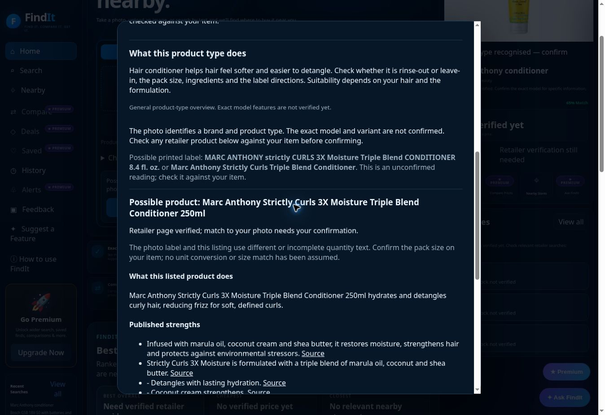

# Product Info and identification precision — 26 October 2026

Focused repair requested by the user: product identification and precise, useful Product Info. Existing design and other features preserved. No paid service, model, credential or plan added. The user explicitly supplied the three images for these tests; the original files were not added to the public repository.

## Delivered changes

PR #328 (`b6467d69`) adds visible identity/evidence scope, observed colour, and product-category verification steps. Complete identities show source links for purpose, strengths, compatibility and included items, plus separate published use/care/ingredients/contents. Scoped HTML definition lists are now read alongside existing structured data and tables. Longer source descriptions retain later connection and package details. Publisher statements remain distinct from independent performance testing.

PR #329 (`4005afdcccfea4a39f64001682a474d87ec5c7c9`) completes quantity precision. Discovery words are separated from quantity text; independently supported quantities remain strict. Exact metric equivalents can match, while different comparable quantities, weight/volume mismatches and numeric substrings such as 250ml inside 1250ml are rejected. A quantity from a single unconfirmed label reader is not copied into the independently supported size field. Cross-unit proposals require explicit pack-size review; fluid ounces are not converted or asserted equivalent to millilitres.

No image-specific hashes, filenames, product facts or recognition shortcuts were added. Vision consensus thresholds and human confirmation requirements remain intact. These changes operate on shared label matching, product descriptions, source attribution and category guidance.

## Actual photo testing

All three attached images were uploaded through the live visible photo picker and Identify & Find, without entering a product name to replace photo identification. No location permission was needed or accepted for Product Info.

| Image | Baseline | Deployed result |
|---|---|---|
| Yellow Marc Anthony conditioner tube | Marc Anthony conditioner; possible printed reading, but no matching candidate details | Final browser build `4005afd…` offers the Strictly Curls 3X Moisture Triple Blend Conditioner 250ml listing for review. Its purpose, strengths, ingredients, directions, warnings and source links render. Photo match and pack size remain unconfirmed. No confirmation button was clicked to disguise this as automatic exact recognition. |
| White/blue Nike shoe | Nike shoes; possible Air Force 1 model | Product Info preserves the observed white/blue appearance, marks Air Force 1 as an unconfirmed suggestion, and specifies the style-code, colourway and UK/US/EU size checks. Exact article code, material and size are not invented. |
| Black boom-microphone headset | Image service could not complete identification | Browser retests and a separate API diagnostic are recorded separately. The API diagnostic returned only the headphones family, with no supported brand/model. One provider reports exhausted credits. Final browser retest on build 4005afd returned headphones, with no supported brand/model. Product Info provides model-label, connector, compatibility and accessory checks, explicitly labelled as general guidance. Broad exact-headset recognition is not certified. |

Before/after DOM snapshots, actual-source JSON, provider diagnostic and screenshots are in `product-info-evidence-2026-10-26/`.

## Breadth and verification

503 Node tests pass. New cases exercise different products and adversarial evidence: unit formatting, wrong quantities, numeric collisions, shoe-size tokens, unconfirmed imperial labels, wrong brands/types, scoped definition lists, excluded footer facts and per-claim source provenance. Existing recognition, matching, commerce and unrelated feature regressions remain included.

Both final PR heads passed all four gates: regression, full audit, release smoke and interaction. New browser regressions pass at desktop 1440px and phone 390px for unrelated example headset and drill products, checking sourced purpose, compatibility, included items, instructions, observed details and overflow. Existing partial-photo confirmation flows also pass at both sizes. Mocked browser evidence tests are not real-photo accuracy measurements.

Additional actual-source text-search flows returned a Bosch GSB 18V-50 kit with 15 published specifications and Levi's 501 listings with variant details kept separate. Shure MV7X returned no verified facts. The Bosch flow was also completed through the deployed customer UI and saved as a separate text-search result, not counted as a successful headset-photo identification.

Cloudflare deployment succeeded. The final browser meta build reports `4005afdcccfea4a39f64001682a474d87ec5c7c9`. All ten workflows associated with final code commit 4005afd completed successfully, including the deployed interaction suite and new Product Info checks. Outcomes are archived in `final-workflows.json`. All twelve workflows associated with the preceding full Product Info deployment b6467d69 also passed.

## Remaining limitations

Precise automatic photo recognition remains incomplete. A possible product is useful research, not proof of the photographed model or variant. Provider availability/credits and product-page discovery still limit coverage. The supplied shoe does not expose its exact style/size label; the headset does not expose a readable model number. Missing evidence stays unknown. These improvements do not certify all products or overall public-launch readiness.
