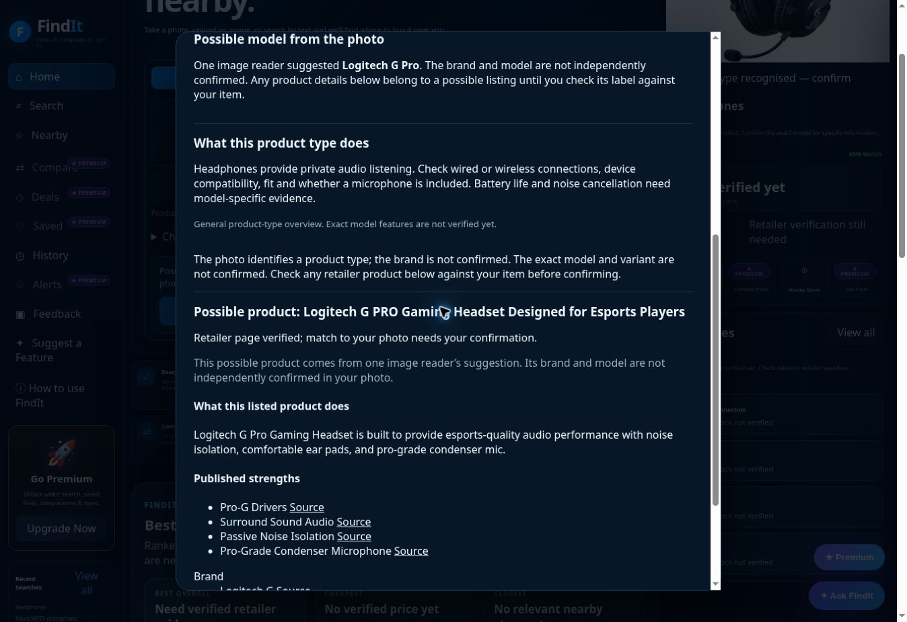

# Product Info coverage continuation — 26 October 2026

Continued the user's instruction to improve identification and provide useful product information across products. Preserved the existing design, features, independent identity thresholds and confirmation requirements. No paid service, credential or plan was added.

## Changes

PR #331 (deployed application commit `f2818f0259731cd5161bd38e924ba016e693ae97`) keeps a specific single-reader model suggestion separate from the independently supported identity when multiple readers agree only on the product type. Product Info can research one unambiguous same-family possibility and display source-backed facts with explicit unconfirmed-brand/model wording. It never copies that suggestion into the photographed brand/model, normal offers, price rankings or stock claims. Conflicting and mismatched hypotheses cannot silently select a product.

A shared manufacturer-source adapter reads live model-specific documents rather than storing product facts. Shure's English public guides are accepted only after exact model/document checks; published units, measurement conditions and footnotes remain attached. Certification and unrelated page content are excluded. The existing Logitech manufacturer source is reused through the adapter. Abbreviated primary Product names can be expanded from the page title only when the brand and exact canonical product URL agree. Recommendation records and different product types are excluded.

The purpose selector now prioritises an identity-matching product definition over a secondary feature such as an adjustable mounting bracket.

PR #332 addresses a production-only source discrepancy: the first deployed Shure request returned an identity mismatch even though local source checks read the guide. The reader now uses the same public document-lookup API as Shure's own website, validates the public English guide and exact model/product IDs, and retrieves the numeric document ID. Website-shell metadata remains a fallback. This is a read-only lookup, with no customer details, location or credentials sent to the manufacturer.

## Real customer results

- **Supplied headset photo:** uploaded through the deployed visible picker and Identify & Find without typing a replacement name. The selected identity stays **headphones**, with brand/model unconfirmed. Product Info now presents **Logitech G Pro** as a single-reader possibility and renders the manufacturer's description and sourced feature headings. No unsupported price was shown. No confirmation button was clicked. This is useful tentative-model research, not certified exact-photo identification.
- **Shure MV7X text search:** the previous flow returned no verified facts. The new source reader retrieves 12 published fields locally, including model, transducer type, polar pattern, frequency response, impedance, sensitivity with conditions, mounting and weight, plus the published XLR connection statement. The initial production failure is preserved; final deployed verification is recorded below.
- **Other actual-source checks:** Bosch GSB 18V-50 kit research returned 15 specifications in one run; another run timed out at the retailer. Levi's 501 research returned matching listings with conflicting variant values kept separate. Both outcomes are retained. Source availability remains variable and is not inferred from green automated checks.

The supplied conditioner and shoe tests from the preceding pass remain documented in [the earlier Product Info audit](PRODUCT_INFORMATION_AUDIT_2026-10-26.md). No image-specific hashes, filenames or product facts were added to application logic.

## Verification and evidence

515 Node tests pass. New tests cover unconfirmed-model isolation, rejection of mismatched/ambiguous suggestions, canonical primary-product identity, unrelated recommendations, source units and conditions, direct public-document lookup, and rejection of private, non-English or mismatched metadata. Desktop 1440px and phone 390px browser regressions verify useful tentative-model details without promoting the selected identity. These are mocked UI evidence tests, separate from the real photo test above.

Both heads of #331 passed all four PR gates, and all 12 associated post-merge workflows passed. All four #332 PR gates and all 11 post-merge workflows passed. Its deployed source recheck nevertheless returned no facts, which is retained as `shure-direct-deployed-failure.json`. #333 adds source-stage/status reporting and retains honest manual-source links for unavailable documents; final deployed outcomes are recorded below. Syntax and diff checks pass. Evidence is in `product-info-coverage-2026-10-26/`, including original source failures and the actual deployed headset DOM/screenshot.

## Remaining limits

Exact photo recognition is still limited by available visual evidence and provider availability/credits. A single-reader possibility is not a confirmed photographed model or variant. A manufacturer guide verifies published product facts; it does not establish retailer price, branch inventory or that a pictured item is that model. Supplier outages and incomplete discovery can still leave exact facts unavailable. Overall public-launch readiness remains withheld.

## Final deployed verification

Application commit `36eb14a24481b7996b17a2e24a0a4c10b09343f8` is deployed (PR #333). The live API reports HTTP 403 at the manufacturer-document metadata stage for Shure MV7X. No exact specifications were returned. The real browser on this build shows general microphone guidance explicitly labelled as general, “Sources unavailable”, the official MV7X guide link, and refresh/correct controls. This source-access limitation remains unresolved; local guide extraction success is not a production success. The original API responses and final browser DOM are retained.

The final application passed 515 Node tests and all four PR gates. Final post-merge workflow results are preserved in `main-workflows-333.json`.
